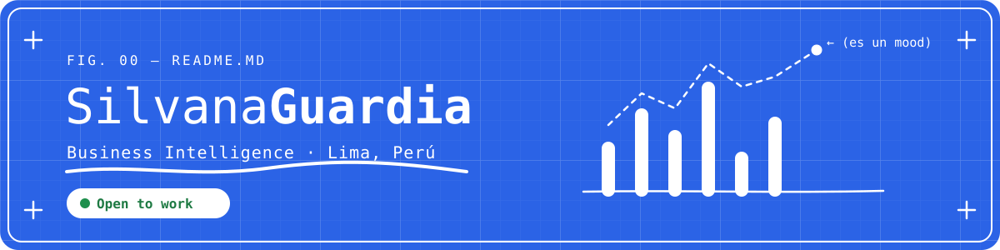
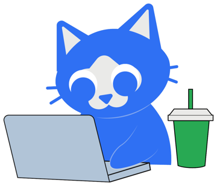

### Hola, soy Silvi 👋

Analista de **Business Intelligence** en Lima, Perú.
Empiezo con una pregunta (a veces seria, a veces un chisme de internet), busco la data y termino construyendo algo con ella: un dashboard, una web o una base de datos.

> Creo que un buen dashboard vale más que mil reuniones.

- 🔭 Ahora mismo estoy rediseñando mi portafolio
- 🌱 Estoy aprendiendo Desarrollo de Sistemas de Información
- 🕒 Mi hora favorita para investigar: las 3 a.m.
- 💼 **Open to work**: análisis de datos, BI y proyectos freelance

<br clear="right">

---


### 🧰Herramientas

**Datos y BI**


**Bases de datos y código**


**Apps y web**


---

### 🗒️Cómo trabajo

```
pregunta → fuentes → datos → limpieza → análisis → algo construido → historia
```

No uso una herramienta para presumir que la sé usar: la elijo según lo que el proyecto necesita.

---

### 📬Hablemos

[](#)
[](#)
[](#)
[](#)

<sub>Llegas por la curiosidad, te quedas por la historia. · © 2026 Silvana Guardia</sub>
